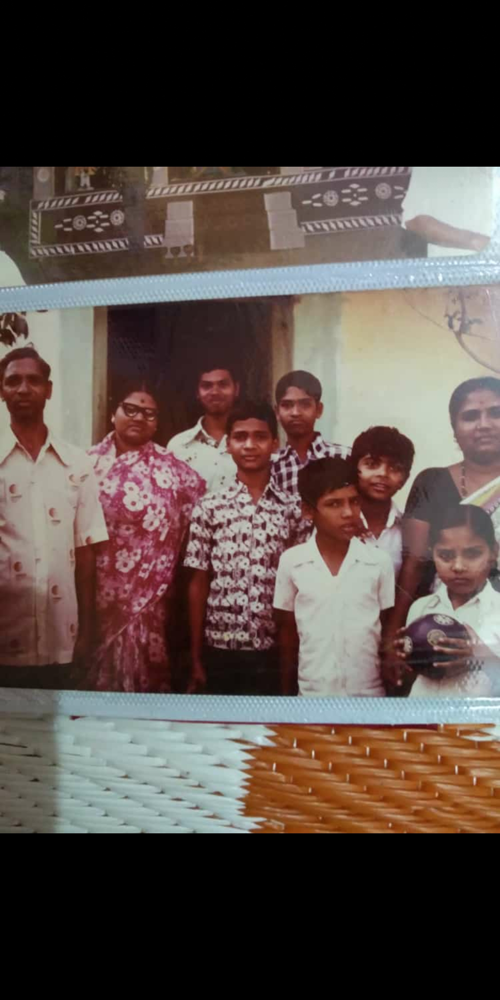
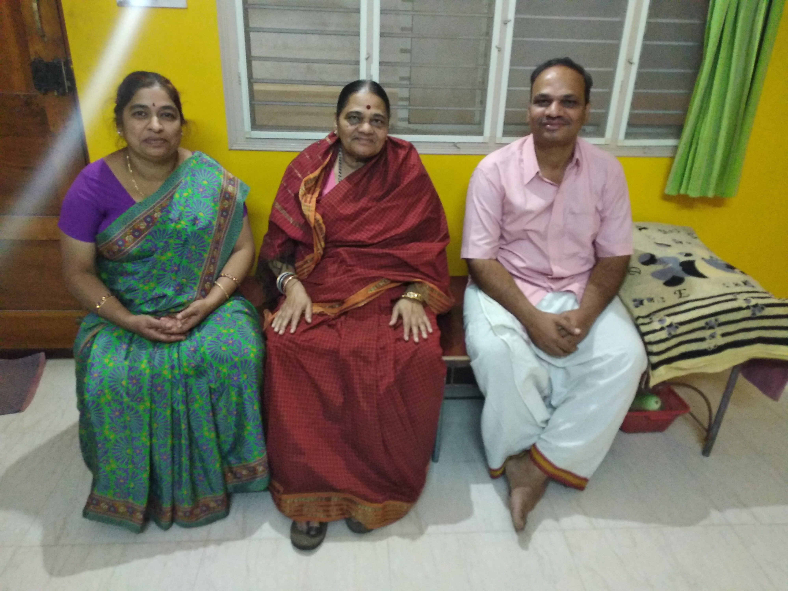
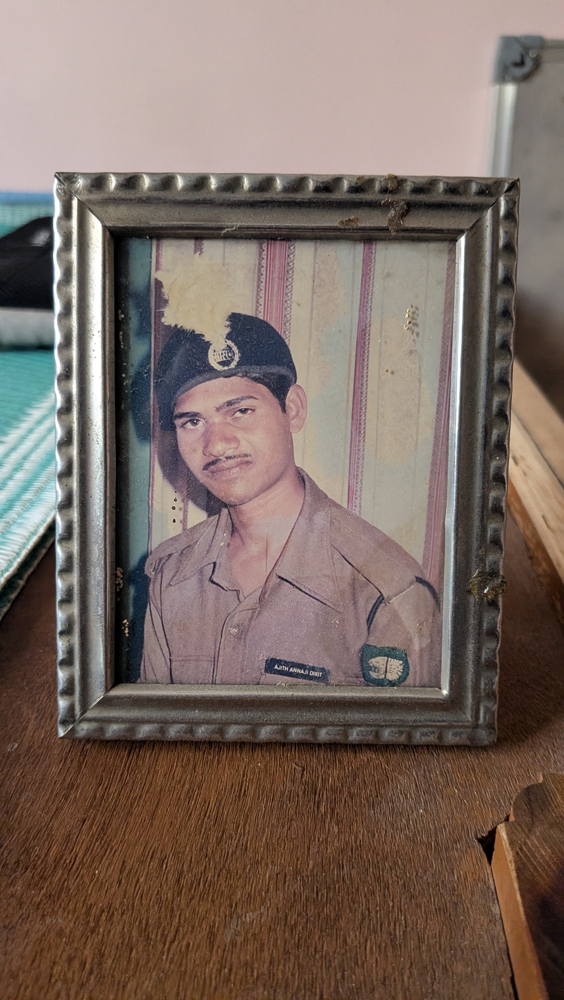
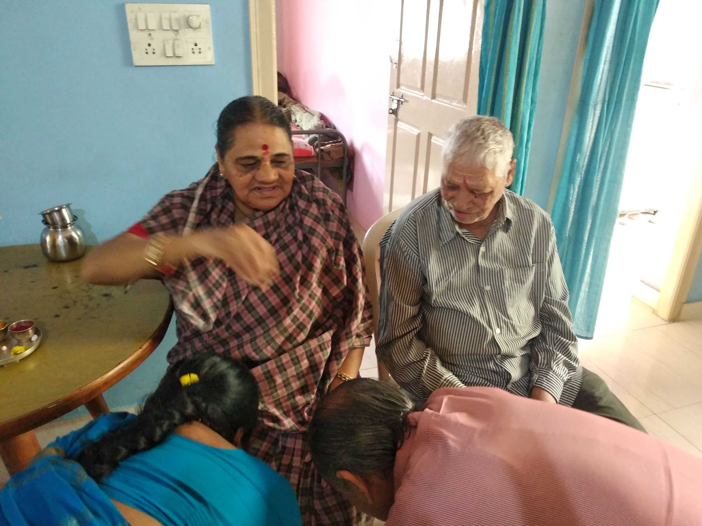
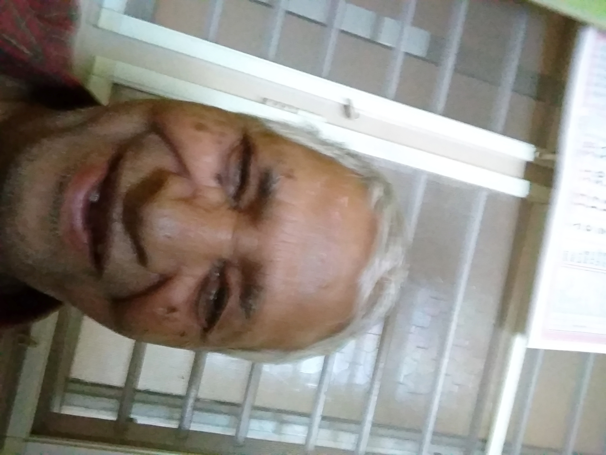

It’s long overdue.  

I have written about civilization, geopolitics, data science, and even paid homage to my grandfather, Ajju. But for years, there has been one story resting heavy in my heart—waiting for the right words, the right moment, and the emotional courage to put on paper. 

I wanted to write about the person who shaped me into who I am today. The person who faced impossible life situations, abnormalities, economic volatilities, and generational poverty; the woman who gave a martyr son to Bharat Mata; the smartest human being I have ever known; and the iron-willed matriarch who handled four children single-handedly.  

Introducing **Vanamala Dixit**—my very own Ajji.  

  
<em>Grace, dignity, and unyielding strength. My Ajji, Vanamala Dixit.</em>  

---

### A Stolen Dream in Bijapur {#a-stolen-dream-in-bijapur}

Born in 1945, she was the second daughter of the large Deshpande family in the district of Bijapur (now Vijayapura). From her early childhood, Ajji was sharp as a whip. She was a brilliant student in school, deeply curious about the world, and held one simple, burning ambition: **to pass her matriculation (10th standard) with flying colours.** In those days, completing 10th standard was a gold standard of academic achievement, especially for a woman.  

But this was 1950s India. Having a girl child of marriageable age was seen as a ticking societal liability—a burden to be passed on to her husband's home as quickly as possible. Despite her protests and her obvious academic brilliance, my Ajji’s dreams were summarily extinguished. 

In 1959, at the mere age of **fifteen**, while she was studying in the 8th grade, she was compelled into marriage. No one paused to consider her potential, no one asked what she wanted, and barely a second thought was given to the financial capability or readiness of the groom. Her books were closed, her childhood was ended, and she was plunged headfirst into the daunting responsibilities of adult life.  

Most people would have let that kind of heartbreak turn into lifelong resentment. Not my Ajji. She channeled that unfulfilled intellectual drive into fierce, razor-sharp practical intelligence that would later save our entire family.

---

### The Crucible of Harihara: Four Children by Twenty-Five {#the-crucible-of-harihara}

Eventually, she began her married life with my grandfather, Annaji (Ajju). The timeline that followed sounds almost unimaginable to our generation today. 

In 1960, at age sixteen, she had her first child—a son. Over the next few years, three more children followed in quick succession, while a fifth pregnancy was tragically miscarried due to an accident. By the age of twenty-five, she was already the mother of four young children, running a household in the small industrial town of Harihara.  

  
<em>The anchor who kept the ship steady through life's fiercest storms.</em>  

Financially, life in post-independence Bharat was brutal. My grandfather worked at Kirloskar in Harihara, but as I wrote in his tribute, Ajju was an easygoing soul by nature—and a massive movie geek! He loved hitting the cinema theatres 5 to 6 times a week. Thank God he didn’t have any destructive vices, but his carefree attitude meant that the burden of running the house, budgeting every single paisa, and feeding six mouths fell squarely on Ajji's shoulders.  

There were days when she didn’t know how to stretch the ration to the end of the week. Affording new clothes for festivals like Deepavali or Ugadi was an uphill battle where money had to be borrowed from relatives or acquaintances. Many were the nights when arguments erupted over responsibility. But through it all, Ajji stood like an impenetrable fortress. She scrimped, saved, negotiated, and held the fort together through sheer, unbending willpower.

---

### The Unapologetic Matriarch {#the-unapologetic-matriarch}

In a deeply traditional, patriarchal society where women were expected to be meek and submissive in the background, my Ajji was the undisputed commander-in-chief of our household. 

She wasn't loud or tyrannical; she commanded authority because she had **earned the right** to do so. She was the one with the financial foresight. She was the one who managed the crises. She was the one who made sure the children studied under kerosene lamps and never missed school. 

I can say this with absolute pride: **it was my Ajji who lifted the Dixit family out of poverty to wherever we stand today.**  

Her primary mission was that her children would not suffer the educational roadblock that had been forced upon her. She pushed, disciplined, and supported them relentlessly. And the results spoke for themselves: despite severe economic hardships, she ensured that **all four of her children earned university degrees.**

---

### The Ultimate Sacrifice: A Veer Mata’s Silent Agony {#a-veer-matas-silent-agony}

Once her children came of age, two of them felt the pull of the nation's uniform. Her second son, Ajit, cleared the grueling selections for the **Border Security Force (BSF)**, underwent elite commando training, and qualified for the **Special Forces**. Her youngest son—my father—cracked the exams and entered the **Indian Army**.  

Imagine the pride in that humble household in Harihara. A mother who had fought poverty with bare hands was now sending her sons to guard the borders of the republic.  

Then came the year 1990. The family had newly shifted to Bangalore, hoping for a peaceful retirement. Instead, a knock on the door brought news that would permanently shatter any mother's heart:  

**Her second son, Commando Ajit Annaji Dixit, had been martyred near Ayodhya at the age of just 25.**  

<em>Commando Ajit Annaji Dixit — Special Forces braveheart who made the supreme sacrifice for Bharat Mata.</em>

  
<em>The sacrifice of a martyr, held in eternal reverence.</em>  

He had drowned during an operation in the holy Sarayu river. She never even saw her son's physical body again—only his sacred ashes, returned draped in the Indian tricolor.  

To lose a son in the prime of his youth is an agony no parent should ever have to bear. But my Ajji bore the mantle of a **Veer Mata** with an almost superhuman dignity. She did not scream at the heavens, she did not curse fate, and she never allowed despair to consume our family. She locked that unbearable sorrow deep within the sanctuary of her soul and kept moving forward, holding the remaining family members upright. Whenever the national anthem played, or soldiers marched on television, she would stand tall with tears in her eyes—tears not of defeat, but of quiet, sacred reverence for the cost her family had paid for Bharat's freedom.

---

### Twenty-Three Years Under Her Tutelage {#twenty-three-years-under-her-tutelage}

I was born in 1998, the son of her fourth child. From the day I opened my eyes until I turned twenty-three in 2021, my entire life was lived under her direct shade and guidance.  

While my parents had their careers, Ajji was my constant teacher, philosopher, and moral compass. She supervised my homework, monitored my behavior, and fed me with stories from the Ramayana, the Mahabharata, and the history of our ancestors. She didn't believe in superficial coddling; if I did something wrong, she would correct me instantly with razor-sharp clarity. But her love was infinite, unconditional, and steadfast.  

She always emphasized one golden principle that remains the foundational cornerstone of my life:  

> ### *"Become whatever you want in life—an engineer, an analyst, a leader—but become a GOOD HUMAN BEING first."*  
> — **Vanamala Dixit**

Those words are permanently burned into my conscience. Every decision I make, every ethical choice I navigate in my career, and every piece of writing I put out into the world is filtered through that lens. If people find me direct, principled, and uncompromising on values today, you can assume without hesitation that **I am the exact reflection of my Ajji.**

---

### An Era Ends, but the Legacy Endures {#an-era-ends}

In 2019, after seventy-four years of an extraordinary, heroic life, my Ajji passed away. Her departure marked the end of an era for the Dixit family. Her loss shattered my Ajju, who survived her for a few more years, carrying their shared memories until he too went to join her.  

  
<em>The matriarch whose legacy lives on in every generation she nurtured.</em>  

People often ask me where I get my resilience from. They ask why I speak up so passionately about duty, civilization, and family. The answer is simple: I was raised by a woman who had every excuse to give up, but chose to conquer every storm life threw at her instead.  

She was denied an education, yet educated an entire family.  
She was born into poverty, yet created an abundance of character and dignity.  
She gave a braveheart son to the nation, and never asked for anything in return.  

Ajji, you may not be here in physical form to watch me grow, build my career, or walk with my wife Shreya, but I know you are watching from above alongside Ajju and Ajit Doddappa. Thank you for your values, your discipline, and your unconditional blessings.  

I will make sure your name and your sacrifices are never forgotten. **Ajji Saan.**
